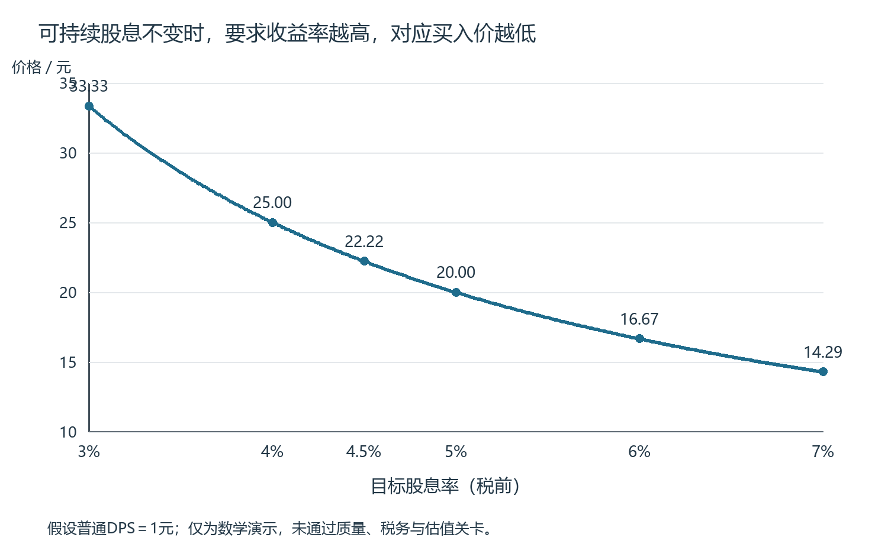
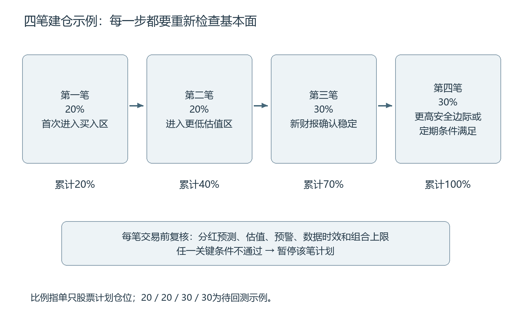
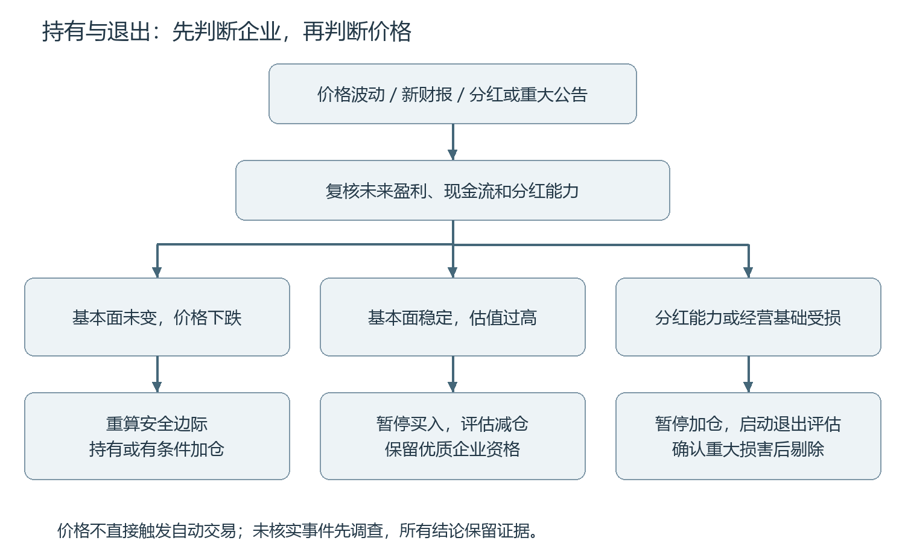

# 分红股投资策略系统——产品设计逻辑与判断标准

V1.1　策略框架与产品需求规范

修订日期　2026年10月16日

## 产品定位

本系统围绕“优质企业持续分红、低估值买入、长期持有收息、基本面动态风控”，把企业研究、价格判断、分批建仓、持仓监控与家庭现金流管理连接为可解释、可复核的决策流程。

系统服务于具备中长期资金安排的个人投资者及研究人员。首期优先覆盖A股，预留港股及港股通的账户、币种和税务口径。输出研究结论与行动候选，不自动下单。

**核心目标是税后可持续现金流与长期总回报**。稳定分红不能保证本金不亏损，现金股息也不能替代对企业价值的判断。

## 参数使用约定

文中30%—70%支付率、4.5%／5%／6%股息率、历史估值分位、建仓比例、组合权重及评分权重均为待回测参考参数，不是已经证实有效的交易规则。行业、利率、税收、企业风险与数据质量变化时，应重新校准。

文中的计算公式属于口径定义；虚构例子用于验证计算和产品行为。数据字段、状态流转及验收条件是产品实现规范。不得把产品验收通过解释为策略有效性已获证明。

## 阅读路径

第1—4章说明目标、八维筛选、行业差异和财务可持续性；第5—7章说明估值、价格区间、建仓及退出；第8—10章说明预警、组合及股息税；第11—14章定义评分、用户流程、数据字段及验收；第15章规定回测和发布要求。

# 1 投资目标与系统边界

## 1.1 四个目标

| 目标 | 判断标准 |
|----|----|
| 现金流可持续 | 企业未来多年有能力支付普通现金股息，分红有盈利与现金流或资本能力支撑。 |
| 买入价格合理 | 同时检验可持续税后股息率、行业估值和安全边际，不为稳定分红支付过高价格。 |
| 本金长期安全性 | 尽量避免企业永久性价值损失；并不保证股价不下跌或净值不回撤。 |
| 低频管理 | 以财报、分红公告和重大事件驱动复核，配合半年至一年全面复盘。 |

## 1.2 现金收入与总回报分别呈现

例如投入100万元，收到5万元现金股息，但持仓市值减少20万元；忽略税费和其他现金流，期间总回报为−15%，不能因为收到股息就认定盈利。

无中途资金进出的简单场景：期间总回报率＝（期末市值－期初市值＋期间净股息－交易费用）÷期初市值。有追加、赎回或股息再投资时，采用明确的时间加权或资金加权口径，避免重复计入股息。

资金安排应能承受20%—30%**回撤**情景，并测试更严重情况；该区间不是最大损失上限。原则上使用3—5年以上无需动用的资金，近期刚性支出由独立现金储备承担。

## 1.3 首期功能与边界

首期包含股票池、**八维研究**、行业指标、分红历史、估值与价格区间、分批计划、持仓账本、事件预警、现金流计算器、参数版本及报告导出。先建设筛选模型，再建设估值模型，最后联通动态监控。

首期不提供自动交易、保证收益承诺或仅按股息率排序的买入指令。无法核实**上市主体**、资产归属、关键数据或账户税务口径的对象，进入待核查状态。

## 1.4 长期纪律

先看企业再看股息；先看多年分红再看最近一年；先确定价值再确定价格；**用正常化股息测算区间**；**分批买入前复核基本面**；质量恶化与价格波动分别处理；同时管理税后现金流和长期总回报。

# 2 八维选股框架

八维覆盖企业质量、买入价格和不可接受风险。行业成熟仅是初筛条件，任何一个高分项都不能抵消已核实的重大风险。研究结论须包含证据、解释、日期和复核人。

| 维度 | 主要数据与判断 | 系统输出 |
|----|----|----|
| 行业成熟度及壁垒 | 需求稳定性、行业地位、生命周期、竞争优势、监管与收费机制 | 成熟度判断与竞争优势证据 |
| 分红历史 | 至少观察连续5年，优先10年；普通**DPS**、减息频率、特别股息、分红变化原因 | 连续派息年数、正常化分红趋势 |
| 支付率与可持续性 | 普通分红／归母利润；多年分红与现金覆盖，30%—70%仅为初筛参考 | 可持续性判断及异常解释 |
| 现金流和负债 | 非金融企业自由现金流、净负债、偿债能力；金融企业改用资本与资产质量 | 行业财务健康结论 |
| 买入价格 | 前瞻税后股息率、历史估值分位、保守内在价值与安全边际 | 建仓上限、加仓条件、高估警戒价 |
| 盈利质量 | 归母利润及正常化利润、ROE、盈利波动、一次性损益 | 长期盈利能力与利润质量 |
| 分红意愿与治理 | 派息政策、历史兑现、管理层资本配置、股东回报、资金占用 | 政策可信度与治理评价 |
| 重大风险 | 财务造假、审计问题、经营模式受损、政策与许可变化 | 否决、暂停或待核查状态 |

## 2.1 研究顺序

首先核实证券、上市公司和真实经营资产；其次判断企业是否有持续盈利与分红能力；再检验价格；最后检验组合是否容纳该风险。不得将“行业重要”或“企业知名”等同于“存在可买上市标的”。

每项可使用合格、关注、不合格、数据不足四种研究标签。质量合格必须同时满足行业适用条件和否决检查，不能仅靠总分越线。

# 3 行业差异与专属分析

首期重点研究银行、公用事业、能源、电信及高速公路等基础设施运营商。进入研究范围不代表全部属于优质分红股。

| 行业 | 核心指标 | 必查风险与估值方式 |
|----|----|----|
| 银行 | 正常化利润、可持续ROE、资本充足率、不良率、拨备覆盖率、净息差、风险加权资产增长 | 信用周期、拨备消耗、资本对派息的约束；PB结合ROE及资本成本，辅以股息率 |
| 公用事业 | 经营现金流、维护与扩张资本开支、债务、电价或收费机制、特许经营权 | 来水量、能源成本、扩建债务及政策调整；PE、FCF收益率与股息率交叉检验 |
| 能源 | 储量、成本优势、商品价格、正常化周期利润、资本开支 | 商品价格下行压力测试；正常化EV/EBITDA与周期中枢股息，避免高景气末期高息陷阱 |
| 电信运营商 | 自由现金流、资本开支、派息政策、竞争力 | 新技术投资及竞争侵蚀；FCF与EV/EBITDA，复核政策兑现能力 |
| 高速公路等基础设施 | 车流量、收费期限、维护成本、现金流、再投资需求 | 收费权到期及资产替换；优先使用剩余期限内现金流折现 |

## 3.1 不得混用的口径

普通工商企业的净负债／EBITDA和自由现金流覆盖率不能机械套用于银行。银行存贷款及资本约束有不同经济含义，应以行业资本、资产质量和监管约束替代。

成熟能源企业仍有强周期风险，成熟银行仍有信用风险。不能因为行业成熟就假设利润和分红恒定。

## 3.2 行业模板

每个行业模板记录适用范围、必填指标、指标方向、阈值版本、异常解释、估值方法及压力情景。未配置行业模板时只展示事实数据，不输出完整评分或正式买入候选。

对监管底线与投资参考阈值分开存储。监管底线按当期有效规定核验，投资阈值通过历史及样本外检验校准。

# 4 分红历史与财务可持续性

## 4.1 分红历史数据

至少支持保存10年普通每股现金股息DPS、年度现金分红总额、分红次数、公告及支付日期、特别股息标记、归母净利润、支付率、DPS同比和政策变化原因。少于5年时提示历史不足，不伪造连续派息年数。

优先研究普通DPS稳定或上升的公司，再比较其估值及财务情况。特别分红结束、股本拆并变化或口径调整造成的表面下降，不自动视为实质减息；先统一每股口径，再解释正常化变化。

普通分红、特别分红与一次性资产处置所得分别记录。出售总部或核心资产产生的高额分红，不可直接外推未来十年。

## 4.2 指标定义

利润支付率＝归属同一利润年度的普通现金分红总额÷该年度归母净利润。

现金流覆盖倍数＝可持续自由现金流÷普通现金分红总额。一般非金融企业的基础FCF＝经营活动现金流净额－资本开支；维护与扩张开支拆分、一次性项目调整均须保留明细。

同时观察最近5年累计FCF／累计普通分红、净有息负债／EBITDA及利息保障倍数。不能将单年经营现金净流入直接等同于可分配现金。

| 情况 | 判断与处理 |
|----|----|
| 多年利润与现金流均覆盖分红 | 优先研究，继续检查投资需求、负债到期与现金受限情况。 |
| 利润覆盖但现金流长期不足 | 核查应收、营运资金、资本开支和利润质量。 |
| 连续多年借债维持分红 | 高风险，暂停买入并评估可持续性。 |
| 分红依靠出售重大资产 | 从可持续DPS剔除异常部分，重算价格。 |
| 支付率暂时超过100% | 核查一次性损益、现金储备及恢复能力，不机械判定永久失效。 |

## 4.3 边界与预测

30%—70%为待回测初筛区间，不是所有行业的硬性淘汰线。净利润≤0时支付率标为不适用并提示亏损分红风险；分红为0时覆盖率标为不适用，不显示无穷大“优秀值”。

预计未来12个月可持续DPS须结合正常化盈利、合理支付率、现金流或资本约束、已公告方案和政策，给出保守／基准／压力情景，记录假设、人工调整和生效时间。

# 5 股息率与估值计算

## 5.1 三种股息率

| 指标 | 计算口径 | 使用目的 |
|----|----|----|
| 历史股息率TTM | 过去12个月实际现金股息／当前股价；普通与特别部分分列 | 描述已发生派息，不能代表未来承诺 |
| 可持续预期股息率 | 未来12个月预计可持续普通DPS／当前股价 | 判断新投资现金回报，分税前与税后 |
| 持仓成本股息率 | 预计年度DPS／持仓每股成本 | 描述原持仓现金回报，不能替代当前估值 |

例：去年DPS为1元，预计未来可持续DPS降至0.70元，股价15元。历史股息率为6.67%，前瞻股息率为4.67%。买入判断应以未来可持续现金流为基础。

股价、股息与持仓成本必须使用一致币种、同一股本口径及明确时点。TTM按实际派付日汇总，年度支付率按利润归属年汇总，避免跨年重复计算。

## 5.2 历史估值分位

| 估值分位区间 | 初始研究状态               |
|--------------|----------------------------|
| [0%, 20%]  | 低估研究区                 |
| (20%, 40%]  | 相对便宜                   |
| (40%, 60%]  | 中性估值                   |
| (60%, 80%]  | 偏贵                       |
| (80%, 90%]  | 高估关注                   |
| (90%, 100%] | 原则上暂停新买入，评估减仓 |

分位参考使用5年或10年可比历史样本，并显示窗口、频率、有效样本数和缺失比例。实现口径：百分位＝（小于当前指标的样本数＋0.5×等于当前指标的样本数）÷有效样本数。

本表用于PE、PB等“数值越高通常越贵”的指标。股息率与FCF收益率方向相反，不能直接套用。负PE、结构性重组及不可比样本须剔除并披露；历史不足时不强行给出分位。

低分位不必然低估。银行PB长期下移可能反映ROE或资产质量变化，必须复核历史区间是否仍具可比性。

# 图例一 股息率与价格

同样是1元可持续税前股息，4.5%、5%、6%的目标收益率分别对应22.22元、20元、16.67元。曲线只表达价格与收益率的数学关系，不表达风险随价格下降而必然减少。

如果盈利恶化导致可持续DPS下调，整条价格曲线也必须重新计算。实际建仓价还受到税后目标回报、行业估值及安全边际约束。

# 6 买入价格区间与分批建仓

## 6.1 三道关与价格公式

只有质量合格、可持续税后股息率达标、行业估值具备安全边际，且数据完整与组合约束通过时，才进入正式买入候选。

P目标股息率＝预计可持续税后DPS÷目标税后股息率。

P安全边际＝保守内在价值×（1－安全边际比例）。

P建仓＝min（P目标股息率，P安全边际）。这是有条件的最高建仓参考价，并不意味着低于该价格均应无条件买入。

P加仓为基本面未恶化时、更有吸引力且满足配置约束的价格；P高估为超过审慎估计价值的警戒价。各价格都需要独立的估值假设与版本，不用人为给股息率加1个百分点替代安全边际估值。

行业估值可采用盈利、现金流或专属模型。现金流折现示意：V＝Σ[CFt／(1＋r)^t]＋终值／(1＋r)^T；FCFE配权益折现率，FCFF配WACC并扣除净债务后转换每股价值。有限收费权不得默认永续，终值必须有权利续期或残值依据。

## 6.2 股息率转价格示例

假设可持续税前DPS＝1元，以下仅为税前数学示例。实际买入须切换至账户适用的税后口径并通过其余关卡。

| 目标股息率 | 对应价格         | 研究动作示例         |
|------------|------------------|----------------------|
| 3%／4%     | 33.33元／25.00元 | 暂不追价／观察       |
| 4.5%       | 22.22元          | 开始考虑             |
| 5%         | 20.00元          | 分批买入候选         |
| 6%         | 16.67元          | 深度研究后可提高配置 |
| 7%         | 14.29元          | 优先排查价值陷阱     |

## 6.3 建仓计划

参考分3—6笔，或按月分批、全年12次；首版测试四笔20%／20%／30%／30%。依次对应首次进入买入区、进一步低估、新财报确认稳定、更高安全边际或定期建仓条件满足。

比例以单只股票计划仓位为分母，不是家庭资产。每次加仓重算DPS、税后回报、估值及组合限额；基本面转差、预警未处理或数据失效时暂停。价格触发与定期触发重合时只生成一笔计划，避免重复下单。

# 图例二 分批建仓与暂停条件

例如单股计划投入10万元，四笔计划金额分别为2万元、2万元、3万元、3万元。若新财报无法确认分红能力稳定，第三笔及后续计划应暂停，而不是为了完成仓位自动执行。

分3—6笔或按月建仓均是待检验的执行方式；不因日历到期或股价下跌就跳过质量检查。

# 7 持有 卖出与剔除

## 7.1 事件处理逻辑

价格显著波动、财报变化或新公告出现后，先重新评估未来盈利、现金流和分红能力，再判断价格与仓位。价格变化本身不直接决定交易。

| 情况 | 决策原则 | 股票池处理 |
|----|----|----|
| 基本面未变但股价下跌 | 重新计算安全边际，可以持有；满足全部建仓条件时才考虑加仓 | 保留研究资格 |
| 基本面稳定但估值过高 | 暂停买入，结合现金流目标、税费、替代标的与仓位评估适度减仓 | 保留优质企业资格 |
| 分红能力受损且原因未明 | 暂停加仓，核查是否暂时性；更新压力情景 | 标记风险复核 |
| 严重造假或盈利模式永久受损 | 启动退出评估，记录证据、处置计划与限制 | 经核实后剔除核心池 |

## 7.2 基本面退出条件

确认严重财务造假、重大资金占用或其他不可接受治理风险；经营许可或关键资产发生重大变化，长期盈利模式受到不可逆损害；正常分红持续失去盈利、现金流或资本能力支持且缺乏可信恢复路径。以上情况不能因价格便宜而被高估值分数抵消。

普通减息需要区分经营恶化、周期变化、特别股息结束、股本调整及资本安排。审计重大保留意见先触发高等级核查，不将所有审计事项自动等同于财务造假。

## 7.3 人工决策与留痕

退出评估记录触发事件、原投资假设、变化证据、预计影响、可交易性、预计税费、决策人和时间。确认剔除与实际卖出分别记录；停牌或流动性不足时，保留待处置持仓及风险提示。

估值减仓不删除企业研究档案；质量剔除保留历史评级与证据。恢复资格必须提供新增证据并重新完成质量与风险审核。

系统不设置由短期跌幅直接触发的统一自动止损规则。用户另行设置交易约束时，应与基本面规则分开显示和审计。

# 图例三 持有与退出决策

估值减仓与基本面剔除是不同决策。前者调整持仓数量，后者重新判断企业是否仍符合长期投资标准。

因特别股息结束或股本变化造成的表面减息，应先还原普通分红口径；确认分红基础长期受损后，再启动相应退出程序。

# 8 预警与复核机制

定期复盘与重大事件即时响应并行。价格和公告按数据源可用频率更新；财报发布后重算模型；每半年至一年全面复盘。尚未配置的数值阈值显示“待设置”，不得暗中使用默认值。

| 监控对象 | 触发条件 | 系统动作 |
|----|----|----|
| 分红公告 | 取消普通分红或显著低于可持续预测 | 红色预警；重算DPS及区间，暂停加仓待复核 |
| 正常化利润 | 非周期企业利润明显下降 | 黄色预警；查明经营与一次性因素 |
| 现金流 | 连续恶化或不能覆盖正常分红 | 黄色或红色预警，结合持续期及原因分级 |
| 财务结构 | 净债务、到期债务或再融资压力快速上升 | 暂停加仓，重做偿债情景 |
| 行业政策 | 收费、许可或监管重大改变 | 重估长期盈利与资产价值 |
| 公司治理 | 造假、重大审计问题、严重资金占用 | 高等级核查，符合否决条件时启动剔除 |
| 市场价格 | 突然大跌或估值极端上升 | 触发复核，不自动交易 |
| 组合配置 | 单股或行业权重超限 | 评估再平衡及新增资金分配 |

## 8.1 状态与处理

预警状态为新建、待核查、处理中、已处置、误报关闭；事件持续但没有新证据时合并更新，新增实质证据可升级。红色未处置时阻断新增买入候选，黄色提示复核；解除阻断须说明依据。

价格跌幅、利润降幅、DPS偏离、持续恶化期数及债务变化阈值按行业配置并待回测。证据不足只显示疑似，不直接断言公司存在违法或永久性损害。

## 8.2 预警证据记录

每条预警保存事件ID、证券、公告标题及链接、发布时间、系统获知时间、报告期、相关财务值、上次预测、新预测、影响程度、命中规则版本、处理结论及操作日志。

产品验收建议：收到可用数据后15分钟内完成事件入库、重算和站内通知；该时效是工程目标，须在数据源与负载验证后确认。上游延迟单独显示，不伪装实时。

# 9 组合配置与家庭现金流

## 9.1 五步规划

先确定每年需要的被动现金流；根据人生阶段选择再投资或支取；建立分散组合；准备现金水池平滑分红到账与月度支出错配；每半年至一年复盘资产质量及现金流目标。

| 项目       | 待回测初始参考                             |
|------------|--------------------------------------------|
| 行业数量   | 至少3个，理想4—6个；同时检查风险因子相关性 |
| 单股权重   | 通常不超过股票组合的10%—15%                |
| 单行业权重 | 通常不超过股票组合的30%—35%                |
| 公司数量   | 可研究8—15只，最终数量以质量及管理能力为准 |
| 现金储备   | 近期刚性支出不依赖尚未到账的股息           |
| 再平衡     | 每半年检查，重大事件随时复核               |

权重按股票组合市值计算，另行显示占家庭可投资资产比例。银行、能源、公用事业虽属不同行业，仍可能受共同宏观、利率或政策因素影响，不能仅凭行业数量认定分散充分。

## 9.2 现金流计算器

预计年度税前股息＝Σ（持股数量×预计年度普通DPS）。预计年度净股息按每个账户、渠道、持仓批次及币种计算税费后汇总；未宣告股息标为预测，不标为应收。

生活开支覆盖率＝预计年度净股息÷年度生活支出。目标本金的简化估算＝年度现金流目标÷假设税后组合股息率；股息率≤0时不输出有效本金估计。

示例：本金50万元、税前股息率5%、年度开支15万元，则税前股息2.5万元、税前覆盖率16.7%。若全部适用20%股息税，忽略其他费用和汇率，净股息2万元、净覆盖率13.3%。这是静态情景，不保证未来收入。

## 9.3 现金水池与压力测试

按月展示期初现金、已确认及预测股息、生活支取、买卖净额和期末现金。现金储备目标由用户设定支出月数，低于目标时提示调整支取、再投资或配置计划。

至少测试普通分红削减、主要行业同时承压、汇率不利变化和股价大幅回撤。股息再投资作为新增持仓处理，避免既计为可支取现金又计为已投资资金。

# 10 股息税与跨市场口径

## 10.1 A股个人持股的差别化税负

以下适用于规定范围内、个人从公开发行和转让市场取得的上市公司股票。税务引擎必须识别账户与证券适用条件，不将其推广至所有机构、境外账户或特殊股份。

| 持有期限             | 股息红利实际税负 |
|----------------------|------------------|
| 1个月以内 含1个月    | 20%              |
| 超过1个月至1年 含1年 | 10%              |
| 超过1年              | 暂免征收         |

依据财税〔2015〕101号及相关操作规定，持股1年以内派息时通常暂不扣缴，转让时按实际持股期限计算并补扣。因此到账现金不一定等于最终税后所得，系统应显示潜在补税，不把暂未扣税认定为免税。

## 10.2 港股通及其他渠道

内地个人经沪港通、深港通投资港股取得股息，相关规定通常按20%代扣个人所得税；H股与非H股的代扣主体、境外已缴税及抵免处理应按具体规定核验。直接境外账户、其他居民身份及机构账户不可简单套用该税率。

同一A＋H公司应分别比较税后股息率、股价、汇率、交易费用、流动性和股权口径。税后DPS＝税前可持续DPS－适用股息税；复杂税务按净额明细计算，不用单一比例掩盖不同税种。

## 10.3 产品要求

保存税收居民身份、账户类型、投资渠道、股票类别、买入批次与日期、拟卖出日期、适用规则和生效期。未知持有期时提供20%／10%／0%情景，不直接假定未来免税。月和年按适用自然月、自然年规则计算，不简单替换为30天或365天。

税务参数按有效期版本化，当前税收口径与历史回测当期规则分开。正式税额以相关规定及登记结算、券商执行结果核对。

## 10.4 法规核验记录

核验日期为2026年10月16日。保留以下法规依据用于税务维护，不作为投资策略的外部背书。

财税〔2015〕101号：https://www.chinatax.gov.cn/n810341/n810755/c1797427/content.html

沪港通税收规定：https://fgk.chinatax.gov.cn/zcfgk/c102416/c5204006/content.html

深港通税收规定：https://fgk.chinatax.gov.cn/zcfgk/c102416/c5203646/content.html

# 11 评分与动态决策表

## 11.1 质量与价格分开

| 项目                 | 权重 | 观察重点                         |
|----------------------|------|----------------------------------|
| 行业成熟度及竞争优势 | 15   | 需求韧性、地位、壁垒             |
| 分红历史             | 15   | 连续派息与普通DPS稳定性          |
| 支付率与可持续性     | 15   | 正常化利润、普通分红、覆盖能力   |
| 现金流和负债         | 20   | 现金质量、偿债能力或行业资本指标 |
| 盈利能力             | 10   | ROE、长期利润及波动              |
| 分红政策与治理       | 5    | 意愿、兑现、资本配置             |
| 估值及买入价格       | 20   | 前瞻股息率、历史分位、安全边际   |

前六项合计质量分80分，价格分20分，总分100分；重大风险作为独立否决层，不另设可被抵消的正向权重。全部权重待回测。

产品实现采用各维度0—100标准分×权重／100。每项必须提供分档定义、行业适用性及证据；未完成分档校准时允许人工研究评分，并明确标识。质量合格线尚待回测及确认，不暗设60分、70分等自动通过线。

缺失指标不计零分、也不按其余项重分权重；显示部分评分、缺失项及“不可完整判断”。正式买入候选必须通过质量、收益率、估值、风险、数据及组合约束。

## 11.2 动态决策表样例

| 股票   | 质量分 | 税后预期股息率 | 估值分位 | 价格状态 | 行动     |
|--------|--------|----------------|----------|----------|----------|
| A 虚构 | 74/80  | 5.8%           | 18%      | 相对低估 | 候选买入 |
| B 虚构 | 70/80  | 4.2%           | 55%      | 合理     | 观察     |
| C 虚构 | 76/80  | 3.1%           | 92%      | 偏贵     | 暂停买入 |
| D 虚构 | 45/80  | 9.5%           | 10%      | 疑似陷阱 | 暂不纳入 |

示例行动假设已经完成对应的人工质量审核，仅用于展示格式，不表示上述分数自动决定行动。详情页显示分红历史、最新财务、价格区间、估值上限、仓位、预警、评分理由及更新时间。

# 12 用户流程与功能需求

## 12.1 完整用户流程

1. 建立账户与目标：填写资金规模、现金流目标、生活支出、投资期限、税务身份、渠道和风险约束；确认计算口径与参数版本。

2. 创建研究池：选择市场及行业，核实证券与经营主体；按八维查看数据，补齐行业专属信息，处理数据缺失与重大风险。

3. 形成研究结论：查看普通与特别分红、支付率和覆盖能力，记录质量判断、评分证据及否决结果。

4. 生成价格区间：确认保守／基准／压力DPS，配置税后目标收益率、估值方法、安全边际，查看建仓上限、加仓条件和高估警戒价。

5. 创建分批计划：确定单股计划仓位、笔数和触发条件；系统检查现金、集中度、红色预警及数据时效，用户确认后记录计划。

6. 记录持仓与现金：导入或录入成交、批次成本、股息、税费和支取；展示现金流日历、目标覆盖率及组合暴露。

7. 处理预警与复盘：查看证据及新旧预测，选择继续持有、暂停、加减仓、退出或剔除，记录理由；按期复盘并导出报告。

## 12.2 核心页面

| 页面           | 必须支持的操作或信息                                   |
|----------------|--------------------------------------------------------|
| 总览与现金流   | 税前／税后预测、到账与潜在补税、月度缺口、风险及集中度 |
| 股票筛选与详情 | 行业过滤、八维证据、评分解释、10年分红、财务及情景价格 |
| 计划与持仓     | 计划仓位、分批进度、实际批次、交易约束、成本股息率     |
| 预警中心       | 等级、证据、规则版本、影响、负责人、处理状态和审计记录 |
| 参数与报告     | 行业模板、阈值状态、税务规则、回测版本、PDF及数据导出  |

## 12.3 权限与可解释性

个人版用户承担研究、确认与操作角色；多人版可拆分研究与复核权限。所有人工修改保留旧值、新值、原因和时间。任何“候选买入”都应能展开显示通过了哪些条件，以及何种条件变化会撤销该状态。

# 13 数据字典与更新规则

各数据集通过证券ID、账户ID、事件ID和版本ID关联。数值须保存单位、币种、报告期、有效时点、公告时点、获知时点与来源链接。缺失值用空值及原因码表示，禁止用0替代。

| 数据集 | 核心字段 | 口径及更新 |
|----|----|----|
| 证券与行业 | security_id、代码、市场、上市主体、行业、币种、资产范围、上市状态 | 主体及行业变化时更新，保留历史映射 |
| 分红事件 | dividend_id、利润归属年、普通／特别DPS、金额、公告／登记／除息／支付日、方案状态 | 提案、批准、实施、取消分开；事件ID去重 |
| 年度分红序列 | 普通DPS、特别DPS、次数、同比、连续年数、政策及原因 | 股本调整后保持可比，保留原始数 |
| 财务与行业指标 | 归母利润、正常化调整、ROE、CFO、资本开支、FCF、净债务、EBITDA、利息；银行及其他专属指标 | 财报后更新；重述另建版本，不覆盖原历史 |
| 行情与估值 | 价格、时间、币种、PE、PB、EV/EBITDA、FCF收益率、窗口、样本数、百分位 | 按约定频率；区分复权分析价与实际成交价 |
| 预测与模型 | 三情景DPS、增长假设、折现率、安全边际、目标税后收益率、三类价位、预测依据 | 保存模型版本、人工覆盖和生效期 |
| 账户与持仓 | 账户身份、税收居民、渠道、批次日期、数量、成本、成交费、股息、税额、汇率 | 交易及派息更新，支持券商账单核对 |
| 组合与计划 | 目标现金流、生活开支、现金储备、计划仓位、分批比例、触发条件、权重上限 | 每次候选动作重新检验组合约束 |
| 风险与评分 | 八维标签、分项分数、否决项、证据、预警等级、状态、处理人 | 事件驱动，保留决策快照 |
| 规则与审计 | rule_id、版本、适用行业、阈值、启用状态、回测状态、操作日志 | 已发布版本不可静默改写 |

# 14 数据质量与PRD验收

## 14.1 数据质量门槛

分红、财务与公告优先使用交易所、上市公司及可靠授权数据；行情记录供应商与时间。财报重述、股本变动、币种换算及重复公告必须处理。缺少DPS预测、行业模板、税务身份或关键财务数据时阻断正式买入判断。

数据时效按字段配置，过期与上游故障展示最后成功更新时间，并停止受影响的新结论。恢复后重算且保留前后差异。每个输出应可回溯至当时已公开数据，不能使用后见信息替换历史。

## 14.2 可执行验收用例

| 用例 | 输入或场景 | 预期结果 |
|----|----|----|
| 股息率区分 | 历史DPS=1、预测=0.7、价格=15 | 历史6.67%、预测4.67%，两者分别展示 |
| 税后价格 | DPS=1、税率20%、税后目标5%、安全边际价18 | 目标价16、建仓上限16；税前20不可误用 |
| 支付率异常 | 净利润≤0；或普通分红为0 | 分别显示支付率／覆盖率不适用，解释原因 |
| 特别股息 | 普通0.5＋特别1.5，下一年仅普通0.5 | 普通DPS未下降；特别股息不得外推 |
| 分位边界 | 20%、40%、60%、80%、90%、90.1% | 落入第5章唯一对应区间，无重叠或漏判 |
| 风险优先 | 价格便宜但重大风险已确认 | 阻断买入；总分不能抵消否决 |
| 分批计划 | 计划金额10万元，四笔20/20/30/30 | 计划2/2/3/3万元；第三笔财报不合格则暂停 |
| 税务期限 | 1个月边界、1年边界、超过1年 | 适用20%、10%、暂免；按自然期限规则检验 |
| 现金流 | 50万元×5%，开支15万元，税率20% | 税前2.5万、净额2万、净覆盖13.3% |
| 数据与重复 | 缺失预测；重复公告；财报重述 | 阻断判断；不重复计股息或预警；版本可追溯 |
| 状态隔离 | 高估减仓；基本面剔除；停牌待退出 | 分别保留资格、撤销资格、保留待处置持仓 |

# 15 回测 发布与持续维护

## 15.1 回测设计

至少检验5—10年可获得的历史数据，覆盖不同利率、商品价格与信用环境。使用当时可知的财报、分红决议、税务与证券状态，纳入退市、停牌和减息企业，控制前视与幸存者偏差。

训练、验证与样本外测试分开，采用滚动窗口检查阈值稳定性。交易成本、买卖限制、税费、汇率、分红到账时点及再投资规则均进入回测；预测股息只能用当时信息构建。

评估总回报、最大回撤、税后股息、现金流波动、减息暴露、换手、集中度、预警误报漏报及现金缺口。与适当红利基准和简单持有策略比较，不仅展示收益率最佳的一组参数。

## 15.2 待回测参数清单

分红历史5年／10年观察窗口；30%—70%支付率；4.5%／5%／6%股息率示例及行业调整；20%和90%等估值分位；3—6笔或按月建仓与20/20/30/30比例；单股10%—15%、行业30%—35%、3至6个行业和8—15只研究规模；80／20质量价格分拆、各维度权重及质量通过线。

利润、现金流、债务、DPS偏离和价格异常的触发数值，安全边际比例、加仓区间和高估价模型也须校准。半年度至年度复盘频率应评估维护成本与风险响应效果。回测不能保证未来表现。

## 15.3 发布验收

功能验收：第14章用例全部通过，三道买入关卡、风险阻断、组合限制、税务情景及状态流转可演示。金额和比例内部保留计算精度，展示按约定舍入；验收比较按显示精度允许末位舍入差。

数据验收：抽查分红、财报、税费与持仓账单，计算可重现；关键缺失和过期数据不生成正式买入状态。性能验收在约定股票池和数据量下验证更新时间、失败重试、去重及事件通知目标。

文档验收：PDF与可编辑Word正文、公式、表格和版本一致，标题正确，字段及参数定义完整；所有参考阈值明确标识待回测，不出现无依据的确定性收益表述。

策略发布：未经回测与研究确认，参数保持“研究示例”；完成检验后记录适用行业、样本、结果、局限及批准版本，再启用正式候选输出。投资判断仍保留人工复核。

## 15.4 维护与复盘

财报和分红公告发布后更新预测；重大风险事件及时复核；每半年至一年检查资产质量、组合集中度及现金流目标。记录每次决策为什么改变，以便区分企业恶化、估值变化、数据修订和原判断失误。
