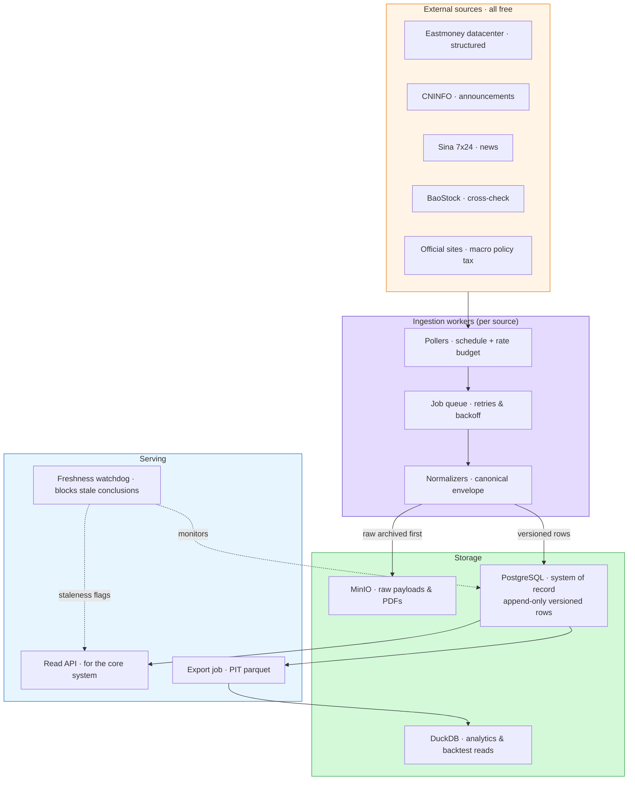

# Data Foundation Layer — Plan

> Plan for the data foundation layer (the "Data Foundation" in [How the System Works](how-the-system-works.md), README Ch. 13–14). Written before any code.
>
> Inputs: [README.md](../README.md) (spec) · [data-sources.md](../research/data-sources.md) (verified sources) · [financial-ai-agent-landscape.md](../research/financial-ai-agent-landscape.md) (research)
>
> **Date:** 2026-11-21 · **Status:** draft for review
> **v1.1 — revised for a free-only source strategy (proof-of-concept budget).**

---

## 1. Summary

- **Problem:** every downstream conclusion in the system (scores, price points, alerts, backtests) needs data that is *complete, provably from the right moment in time, and traceable to a source*. Today no such layer exists.
- **Budget decision (v1.1):** all sources are **free** for the POC. Tushare Pro (¥200/yr) is deferred and documented as the paid upgrade path — it is only bought if we later need vendor-guaranteed restatement history.
- **Sources (free, live-verified where noted):** Eastmoney datacenter keyless JSON APIs as primary for structured data (statements carry `NOTICE_DATE`; dividends carry `PLAN_NOTICE_DATE`/`EX_DIVIDEND_DATE`/`ASSIGN_PROGRESS` — both verified 2026-11-21); CNINFO as primary for announcements; Sina 7x24 for news; BaoStock for cross-checking; official sites (PBOC, NBS, NDRC, NEA, MOT, tax authority) for macro/policy/tax; AkShare as a pinned adapter library.
- **Method:** per-source poller workers → job queue → normalizers → append-only, versioned storage; dedup by natural keys; cross-source disagreement tracking; a freshness watchdog that blocks stale conclusions.
- **Effectiveness, defined:** the pipeline's job is *collect → normalize → output effective data*: deduplicated, provenance-carrying, announcement-date-gated rows the core system can consume without trusting any vendor's current display. Perfection of historical restatements is explicitly out of scope (see §3.5).
- **Stack recommendation:** PostgreSQL (system of record) + MinIO (raw payloads and PDFs) + DuckDB (backtest analytics) + Python workers. No heavyweight orchestrator in phase 1.
- **Plan shape:** four phases — Phase 0 spikes (prove the risky assumptions, ¥0 spend), Phase 1 structured data, Phase 2 text sources, Phase 3 quality gates and backtest export. Each phase ends with executable acceptance tests (many already defined in README Ch. 14).
- **Open items:** deployment location (mainland vs not), source terms-of-use review, BaoStock dividend coverage (needs an empirical test), whether intraday data is ever needed.

---

## 2. Overview

### 2.1 The problem we are solving

The spec defines the data foundation through three hard rules, and everything else follows from them:

1. **Point-in-time (时点口径).** A conclusion computed on date D may only use facts that were publicly available on D — announced, not merely observed; original statements, not restated ones (Ch. 14.1). This is what separates a credible system from a fantasy backtest, and it is the single most expensive property to engineer.
2. **Provenance on every value.** Every record carries unit, currency, reporting period, announcement time, time-learned, and source link (Ch. 13). Every output must trace back to raw data and the rule version that produced it.
3. **Missing or stale data blocks conclusions.** Missing values are never 0; expired or failed data stops affected conclusions and shows last-successful-update time (Ch. 13, 14.1). Deduplication and restatement-versioning are mandatory (Ch. 14.1, 14.2).

Operationally, the layer must also meet the spec's one latency target: announcements ingested, models recomputed, and users notified within 15 minutes of usable data (Ch. 8.2) — with upstream delay displayed honestly, never faked as real-time.

**In one sentence:** the data foundation is the system's memory — an append-only, provenance-carrying store that can answer "what did we know, when did we know it, and where did it come from" for every fact the rest of the system consumes.

### 2.2 Requirements distilled

| # | Requirement | Spec ref |
|---|---|---|
| R1 | Metadata on every value: unit, currency, report period, announcement time, time-learned, source link | Ch. 13 |
| R2 | Point-in-time queries: facts usable only from announcement date; restatements create new versions, never overwrite | Ch. 13, 14.1 |
| R3 | Missing ≠ 0; missing reason codes; blocking when critical data absent | Ch. 13, 14.1 |
| R4 | Dedup: same fact from repeat deliveries or multiple vendors counted once | Ch. 14.1, 14.2 |
| R5 | Freshness: per-field staleness config; expired data stops new conclusions; recovery recomputes with diff | Ch. 14.1 |
| R6 | Announcement latency target: 15 min from usable data to ingestion + recompute + notify | Ch. 8.2 |
| R7 | Entity linkage: security_id / dividend_id / event_id / version_id join everything | Ch. 13 |
| R8 | ID-stable, idempotent ingestion: re-runs safe, history replayable | implied by Ch. 13–14 |
| R9 | Source priority & cross-validation: official/authoritative sources preferred | Ch. 14.1 |

### 2.3 Data type → source mapping (free-only, v1.1)

| # | Data type (spec Ch. 13) | Primary source | Backup / validation | Method |
|---|---|---|---|---|
| 1 | Securities master & industry | AkShare code lists (Eastmoney) | SSE/SZSE registers, BaoStock, Shenwan classification | JSON API, daily |
| 2 | Quotes & valuation ratios | AkShare daily OHLCV + 复权 (Eastmoney/Sina) | BaoStock bars & adjust factors | JSON API, EOD daily |
| 3 | Financial statements & indicators | **Eastmoney datacenter keyless API** (`RPT_DMSK_FN_BALANCE/INCOME/CASHFLOW`) — `NOTICE_DATE` live-verified 2026-11-21 | BaoStock statements, CNINFO filing PDFs | JSON API, event + periodic |
| 4 | Dividend events & DPS series | **Eastmoney `RPT_SHAREBONUS_DET`** — lifecycle fields live-verified (history from 2000) | BaoStock `query_dividend_data` (adds after-tax DPS + pay date), CNINFO announcements, SSE page | JSON API, daily + on announcement |
| 5 | Announcements (full text) | CNINFO `hisAnnouncement/query` | SSE/SZSE disclosure search, AkShare | POST API, polled 5–15 min |
| 6 | News | Sina 7x24 `zhibo` feed | 财联社 web, Eastmoney news | JSON feed, polled 5–10 min |
| 7 | Research reports | 东方财富研报中心 keyless API | (scarcest category — see [data-sources.md](../research/data-sources.md) §7) | JSON API, daily |
| 8 | Macro / rates / FX | PBOC + Chinamoney + NBS | SAFE, Chinabond | Web + export files, daily |
| 9 | Industry policy & concessions | NDRC / NEA / MOT + company filings | (paid DBs deferred indefinitely) | Web + filings, weekly |
| 10 | Tax & legal rules | 国家税务总局法规库 | MOF, CSRC databases | Web, monthly + on change |
| 11 | Corporate actions (股本变动/配股/回购) | AkShare (Eastmoney) | BaoStock adjustment factors, CNINFO | JSON API, daily |

### 2.4 Assumptions and open questions

**Assumptions (stated so they can be corrected):**
- Phase 1 is single-tenant (us), local or small-VPS deployment, Python throughout, Docker available.
- **Free-only sourcing for the POC (v1.1).** Tushare Pro remains documented as the upgrade path (§3.5 explains exactly what it would buy).
- No intraday/minute data in phase 1 (EOD prices only) — nothing in the spec needs it yet, and free minute data is effectively nonexistent.
- Commercial terminals (Wind/iFinD/Choice) and JQData are out of scope (cost; JQData is mainland-only).
- Data volumes are tiny: ~5,400 A-share listings → ~1.3M daily price rows/yr, ~22k statements/yr, ~6k dividend events/yr, ~1M announcements/yr market-wide. Everything fits comfortably in PostgreSQL.

**Open questions for us to answer before Phase 1:**
1. Will deployment be inside mainland China? (Affects site accessibility — CNINFO/Sina/Eastmoney verified working from our current network.)
2. Do Eastmoney/CNINFO terms permit our planned storage (internal use, no redistribution)? — partner to review; free does not mean term-free.
3. Is the 15-minute SLA a hard requirement or a target? (Drives polling design vs. future paid push feeds.)
4. Retention policy: keep raw payloads forever, or N years? (Cheap either way; policy matters for compliance.)

---

## 3. Methodology — how we acquire data automatically

### 3.1 Acquisition methods, by preference

1. **Official keyless JSON APIs (preferred).** Eastmoney datacenter (`datacenter-web.eastmoney.com`, live-verified: statements with `NOTICE_DATE`, dividends with full lifecycle), CNINFO (`POST hisAnnouncement/query`, live-verified), Sina zhibo feed (live-verified). Deterministic, versionable, automatable — and more stable than HTML scraping because the JSON contract rarely changes.
2. **Export endpoints.** Chinamoney (Excel), NBS `easyquery` (CSV/JSON), Chinabond (registered download). Semi-automatable; parsed into canonical schema.
3. **Web pages / PDFs (controlled scraping, low frequency).** PBOC, NDRC, NEA, MOT, tax authority — policy documents and bulletins change slowly; poll weekly/monthly, store the raw document, extract the facts.
4. **Adapter libraries as a channel, not an abstraction.** AkShare is a scraping adapter over the same Eastmoney/Sina/THS endpoints; it breaks when upstream pages change and has no SLA. Use it where it is the most convenient wrapper, **pinned to a version**, with the raw responses archived — never as an irreplaceable dependency.
5. **No push feeds** exist for our sources at this price point — so acquisition is **poll-based by design**, with cadences tuned per type (below). A paid push feed (e.g., Futu OpenD or commercial terminals) is the future escape hatch if the 15-min SLA ever fails on polling.

### 3.2 Pull cadences

| Data type | Cadence | Rationale |
|---|---|---|
| Announcements (watched securities, fast lane) | 5 min | Feeds the 15-min alert SLA (Ch. 8.2) |
| Announcements (general market) | 15–30 min | CNINFO throttling limits full-feed polling; general lane backs the research pool |
| News | 5–10 min | Alert context; Sina feed is cheap to poll |
| Prices + adj factors + valuation | EOD daily (after 15:30 CST) + weekend repair | Trading calendar-driven |
| Financial statements | Event-driven (report season) + daily sweep | Reports appear in windows (Apr/Aug/Oct); `NOTICE_DATE` marks PIT |
| Dividends & corporate actions | Daily + on announcement | Eastmoney `ASSIGN_PROGRESS` lifecycle; CNINFO triggers re-check |
| Macro / rates / FX | Daily (rates, FX) / monthly (GDP, CPI already published) | Publication calendars |
| Research reports | Daily | Low priority for alerts |
| Industry policy | Weekly sweep | NDRC/NEA/MOT publication patterns |
| Tax & legal rules | Monthly + on partner request | Rule changes are rare but must be versioned (Ch. 10.3) |

### 3.3 Provenance and normalization

Every ingested record is normalized to a canonical envelope:

```
source · source_record_id · published_at (公告时点) · fetched_at (获知时点)
as_of (data effective date) · report_period · currency/unit · version · raw_ref
```

- `published_at` drives PIT correctness; `fetched_at` drives pipeline health (the Ch. 8.2 SLA measures published→fetched→stored→recomputed).
- Normalization includes: unified security IDs, currency fields, Shenwan industry mapping, share-class separation (A/H), date-time in Asia/Shanghai with explicit trading calendar.
- Raw responses and PDFs are always archived first (MinIO), so backfills and replays never depend on the vendor still serving the data.

### 3.4 Reliability mechanics

- **Idempotency:** natural keys per type (dividend: security + 预案公告日 + 方案; announcement: CNINFO `announcementId`; price: security + trade_date; statement: security + report_period + version).
- **Retries with exponential backoff** through a job queue; dead-letter table for poison jobs; no silent drops.
- **Rate-limit budgets per source** (CNINFO informal throttling and pageSize 30; Eastmoney/Sina request courtesy); a per-source token schedule in config.
- **Backfill/replay:** from the raw store, re-run normalizers; useful for schema fixes and cross-source re-validation.
- **Cross-validation (R9):** for the handful of critical facts (dividend amounts/dates, statement totals), compare Eastmoney vs BaoStock on ingestion; mismatches land in a `quality_disputes` table for the alert center to surface — never silently resolved.

### 3.5 Point-in-time strategy under free sources (v1.1 — the key trade-off)

The paid Tushare tier's one irreplaceable feature was vendor-maintained restatement flags (`update_flag`). Free sources don't publish those — so we build the PIT property ourselves from three mechanisms:

1. **Announcement-date gating (M1).** Use the vendor-provided notice dates as the availability axis: `NOTICE_DATE` on statements, `PLAN_NOTICE_DATE`/`EX_DIVIDEND_DATE` on dividends, CNINFO publish dates on announcements. **Both date fields live-verified working 2026-11-21** — this gives us "what was knowable when" for the whole history these APIs cover (statements and dividends back to ~2000).
2. **Forward restatement detection (M2).** Re-poll each report period for N quarters after publication and store a hash of the values. If a re-fetch differs from what we recorded, that is a restatement → new version row with `observed_at`. No free vendor will tell us this; we become the detector. This means the system's PIT accuracy *grows over time* from the day we start polling.
3. **The announcement archive (M3).** CNINFO PDF snapshots record what was announced and when — the event-side ground truth and the raw material for re-parsing.

**Honest limitation, accepted for the POC:** historical restatements *before* we start snapshotting cannot be reconstructed from free sources (e.g., a 2022 statement revised in 2023 will look "already revised" to us in 2026). The practical impact is small for a POC — dividend-stock research depends far more on announcement dates and lifecycle states than on pre-revision financial minutiae — but it must be stated. **Tushare's ¥200/yr tier is the documented fix if this ever matters** (its `update_flag` encodes exactly this history). Nothing about the architecture changes either way: append-only rows, provenance envelope, and versioned storage serve both.

One known gap to close in Phase 0: Eastmoney's dividend report has no pay-date field (verified absent). Fill it from BaoStock (`dividPayDate`) and CNINFO implementation announcements (实施公告) — both free.

---

## 4. Architecture options (acquire, store, manage — asynchronously)

You asked for options, so here are three, with a recommendation. (§4.5 explains the database pieces in plain language.)

### 4.1 Option A — Single service + PostgreSQL

One Python app: scheduled jobs (in-process scheduler) pull sources, normalize, and write directly to PostgreSQL. Raw files on local disk.

- **Pros:** fewest moving parts; easiest to reason about; fine at our data volumes.
- **Cons:** a stuck poller blocks everything; retry/backpressure logic gets tangled in the app; scaling later means rewriting. Local-disk raw storage is fragile.

### 4.2 Option B — Ingestion workers + PostgreSQL + MinIO + DuckDB ⭐ recommended

Separate ingestion workers (one per source family) pull and normalize; a lightweight job queue handles retries/backpressure; PostgreSQL is the system of record; MinIO holds raw payloads/PDFs; DuckDB reads exported parquet for backtest-grade analytical queries.

- **Pros:** source failures isolated; queue gives idempotent retries for free; the raw archive makes point-in-time *rebuilds* possible (the announcement archive the research doc said we must build); DuckDB makes multi-year PIT backtest scans fast without a warehouse. All components are free, boring, and well-documented.
- **Cons:** more components than A (queue, object storage) — but each is a single container in Docker Compose.

### 4.3 Option C — Orchestrated data platform (Airflow/Dagster + warehouse)

A proper data platform: DAG orchestration, data catalog, warehouse (ClickHouse or similar), monitoring.

- **Pros:** the "right" answer at institutional scale; nice lineage/observability.
- **Cons:** heavy ops burden for two people; most of its value targets problems (hundreds of pipelines, big data) we don't have. Revisit only if the product becomes multi-tenant with real-time feeds.

### 4.4 Comparison

| Criterion | A · single service | B · workers + queue ⭐ | C · platform |
|---|---|---|---|
| Complexity to build | Low | Medium | High |
| Ops burden | Low | Low (one compose file) | High |
| Failure isolation | None | Good | Good |
| Raw archive / PIT rebuilds | Weak | Built-in | Built-in |
| Backtest scan speed | Postgres only | DuckDB | Best |
| Fits 2-person team, phase 1 | ✔ | ✔✔ | ✖ |

### 4.5 Database primer (no prior DB experience assumed)

- **PostgreSQL — the ledger of truth.** A relational database: transactional, proven, supports JSONB columns and timestamps with time zones. Our data is relational by nature (the spec's IDs literally join it), and Postgres handles versioned/append-only patterns well (see §6.2). ~1–2M rows/yr is nothing for it.
- **Object storage (MinIO — a local, open-source S3 clone) — the filing cabinet.** For big, write-once files: announcement PDFs, raw JSON responses. Cheap, immutable, not a database — you don't query inside it, you fetch by key. Use real S3-compatible cloud storage later if we move off-prem.
- **DuckDB — the analytical engine.** An embedded (no server) columnar database that reads parquet files directly. Backtests need "as-of date X, give me every statement announced before X for 300 stocks over 8 years" — that's a scan Postgres would be slow at, and DuckDB does in milliseconds. It is a *derived* store: Postgres remains the source of truth; an export job feeds DuckDB.
- **What we deliberately skip for now:** MongoDB (document DB — weaker for our joins/audit), ClickHouse (great for ticks; we have no tick data), Airflow/Dagster (orchestration overhead), and a message broker like Kafka (overkill at ~1M events/yr; a DB-backed queue suffices).

### 4.6 Recommended architecture



- **Pollers** pull on per-source cadences with rate budgets; every job is queued, retried, and logged.
- **Normalizers** map raw → canonical envelope, archive the raw payload, then write versioned rows.
- **PostgreSQL** answers the core system's questions today; **DuckDB** answers backtest questions about the past.
- **Watchdog** compares `fetched_at` against per-field freshness configs and marks affected entities stale — the enforcement of R5, wired into the read API so the core system's conclusions auto-block (Ch. 14.1).

---

## 5. Specific implementation planning

> **Placeholder by design.** Detailed task breakdown, schema definitions, and per-phase tickets will be written here after we agree on the architecture option and the open questions in §2.4. Planned outline:

1. **Phase 0 — Spikes (prove assumptions before building, ¥0 spend):**
   - **Spike A — free-PIT probe:** 10 banks/utilities × 10 years. Verify Eastmoney statement `NOTICE_DATE` quality and coverage; verify dividend lifecycle fields incl. `ASSIGN_PROGRESS` transitions; fill the missing pay dates via BaoStock + CNINFO; build a toy as-of-2024-06-30 view and diff it against a naive "latest data" view (proves R2 is achievable for ¥0).
   - Spike B: CNINFO poller prototype — measure real throttling behavior and end-to-end publish→store latency (validates the 15-min SLA against R6).
   - Spike C: BaoStock `query_dividend_data` coverage test for years after 2017 (resolves the data-sources.md open flag).
2. **Phase 1 — Structured core:** securities master, prices, financials, dividends, corporate actions. Schema, pollers, queue, MinIO archive, basic read API.
3. **Phase 2 — Text sources:** CNINFO announcement pipeline (fast lane + general lane), Sina news, macro/policy/tax sweepers, research reports.
4. **Phase 3 — Quality & serving:** freshness watchdog, cross-source dispute table, restatement snapshotting (M2), PIT parquet export to DuckDB, Ch. 14 acceptance suite wired as CI tests, latency dashboards for the 15-min SLA.

*(Fill in: schema DDL, task list, effort estimates, test matrix.)*

---

## 6. Review — my assessment

### 6.1 What is still missing (risks and gaps)

1. **Unofficial-API fragility is now the top operational risk.** Eastmoney's keyless JSON APIs and AkShare's scraped endpoints can change or break without notice. Mitigations built into the plan: call keyless JSON directly wherever possible (not HTML), pin AkShare, archive every raw response (MinIO), and cross-validate Eastmoney vs BaoStock so silent breakage surfaces as disputes, not wrong conclusions.
2. **The point-in-time announcement archive has no off-the-shelf answer.** We must snapshot CNINFO ourselves (research doc §2.4). This is the single riskiest build — it is also unavoidable and now live-verified feasible.
3. **The 15-min SLA vs. free-source throttling.** CNINFO has informal anti-crawler limits; the fast/general two-lane polling design is a hypothesis that Phase 0 Spike B must prove or break. If it breaks, the honest fallback is to state latency honestly (the spec itself demands this) and buy a push feed later.
4. **Restatement history is a consciously accepted gap.** Free sources give us announcement-date gating and forward snapshotting, but not the past's restatements (§3.5). For a dividend-POC this is a reasonable trade; the Tushare upgrade path stays documented in the plan.
5. **The Eastmoney pay-date gap.** The dividend report lacks a pay date (verified); BaoStock + CNINFO fill it — but the join must be validated in Spike A, or cash-flow calendars will be wrong.
6. **Cross-source disputes need an owner.** The `quality_disputes` table flags mismatches, but the partner must define resolution policy — spec Ch. 14.1 says prefer official sources, which is a start but not a resolution rule.
7. **Source terms.** Storing Eastmoney/CNINFO data (even privately) sits under their service terms — free does not mean term-free; the partner should review before we scale storage. We only store for internal use; no redistribution.
8. **The tax/legal data type is easy to under-build.** Rule *versions with effective dates* (Ch. 10.3) must be first-class from day one — retrofitting versioning onto a naive rules table is painful.
9. **Ops fundamentals people forget in phase 1:** secrets management (even for keyless APIs, keep headers/cookies out of git), backup/restore drills for Postgres + MinIO, and monitoring that the *free* endpoints themselves haven't died.

### 6.2 Suggested architecture

**Option B, concretely:** Python 3.12 workers (per-source poller processes) + a DB-backed job queue (arq or Celery with Postgres broker — no Redis needed) → PostgreSQL 16 with append-only, versioned tables and JSONB raw envelopes → MinIO for payloads → DuckDB + parquet for backtest exports → a thin FastAPI read layer with freshness-gated queries. Everything in one Docker Compose file. This gives failure isolation, replayability, and the PIT properties the spec demands, at the lowest ops cost I can justify — with a clean upgrade path to Option C only if the product becomes multi-tenant. The free-only source change does not alter this architecture; it changes the adapter layer and adds the M1/M2/M3 mechanisms (§3.5).

### 6.3 Suggested implementation scheme

Follow the phase order in §5, with one rule enforced throughout: **each phase ends with executable acceptance tests, most of them already written for us** — the README Ch. 14 cases (dedup, restatement versions, missing-forecast blocking, tax boundaries) plus our own PIT probes ("the as-of view built from `NOTICE_DATE`-gated rows must exclude the Q3 report before its publication day"). Rough sizing: Phase 0 ≈ 1 week (the spikes decide feasibility, not the code), Phase 1 ≈ 2 weeks, Phase 2 ≈ 2 weeks, Phase 3 ≈ 1–2 weeks — a 6–7 week path to a data foundation the rest of the system can trust, at a data cost of **¥0**.

**My honest recommendation:** approve Option B and start Phase 0 Spike A immediately. It costs nothing, and it answers the only question that matters before building: can a free stack actually deliver announcement-date-gated, cross-validated data for statements and dividends? The evidence so far (both APIs live-verified today) says yes — the spike proves whether it holds at depth.
