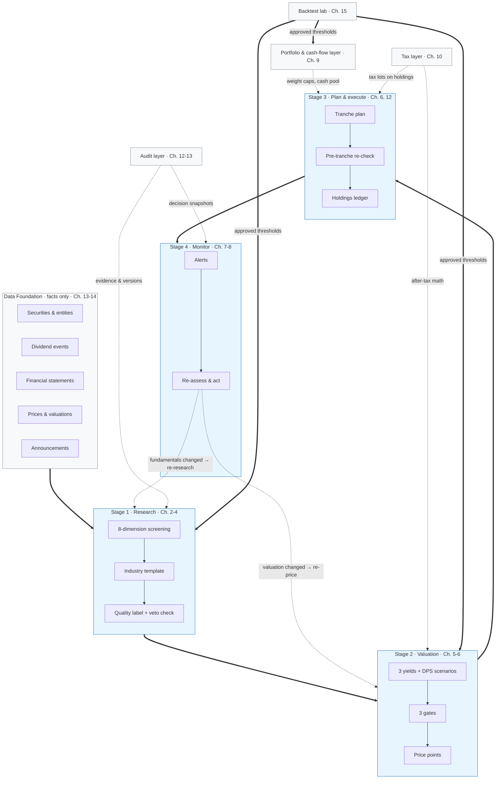
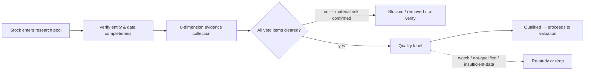
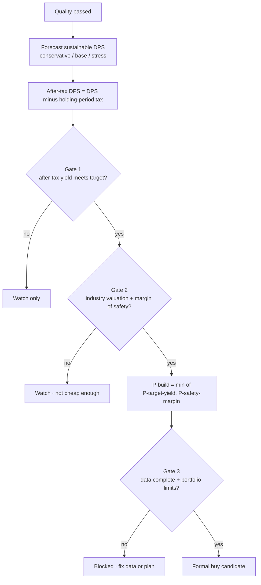
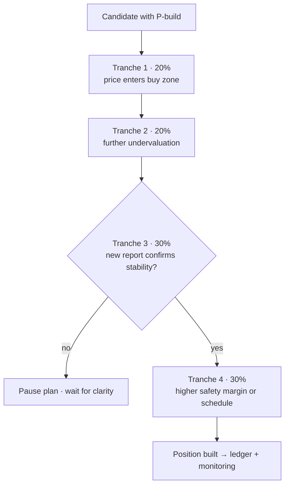
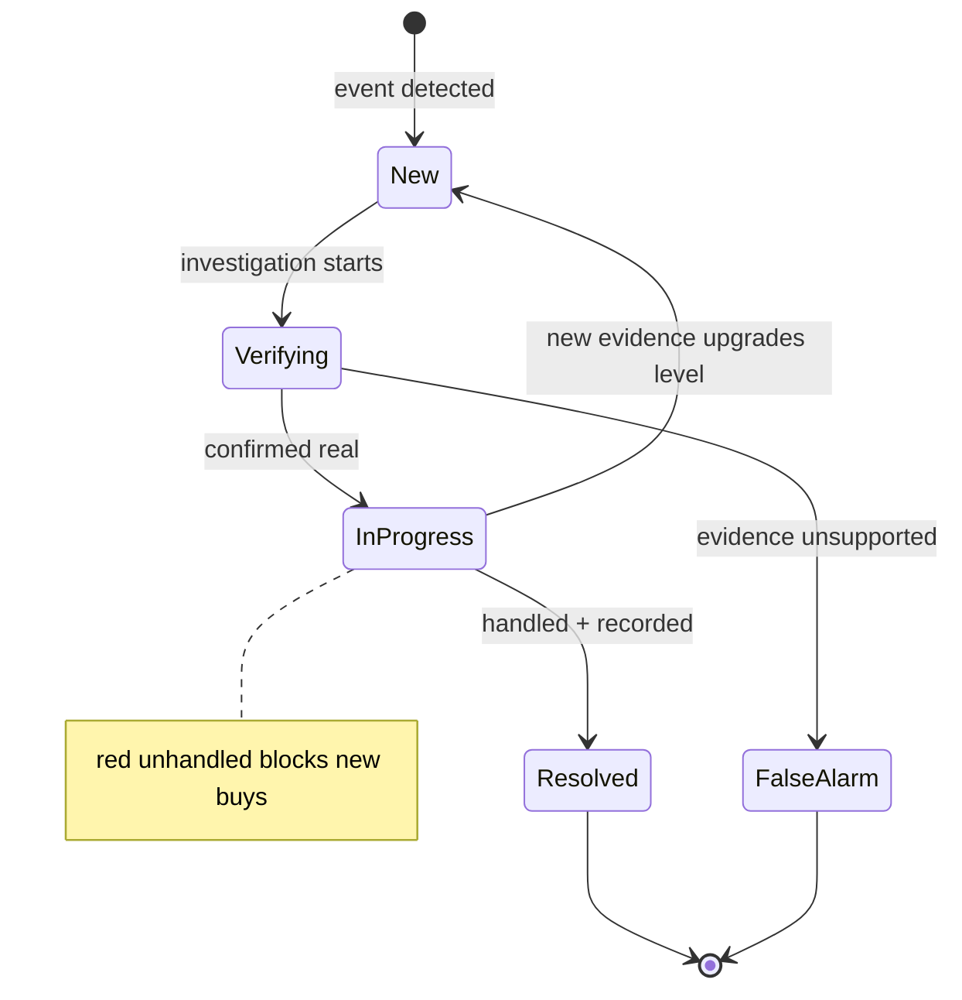
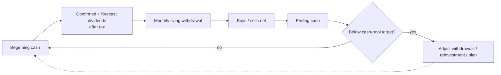
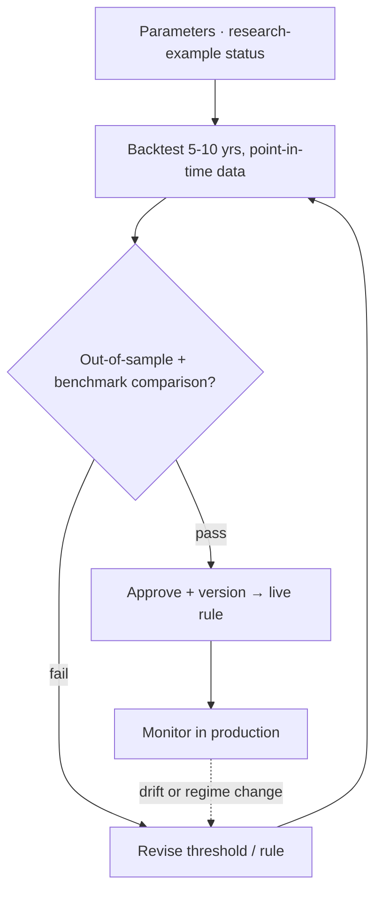
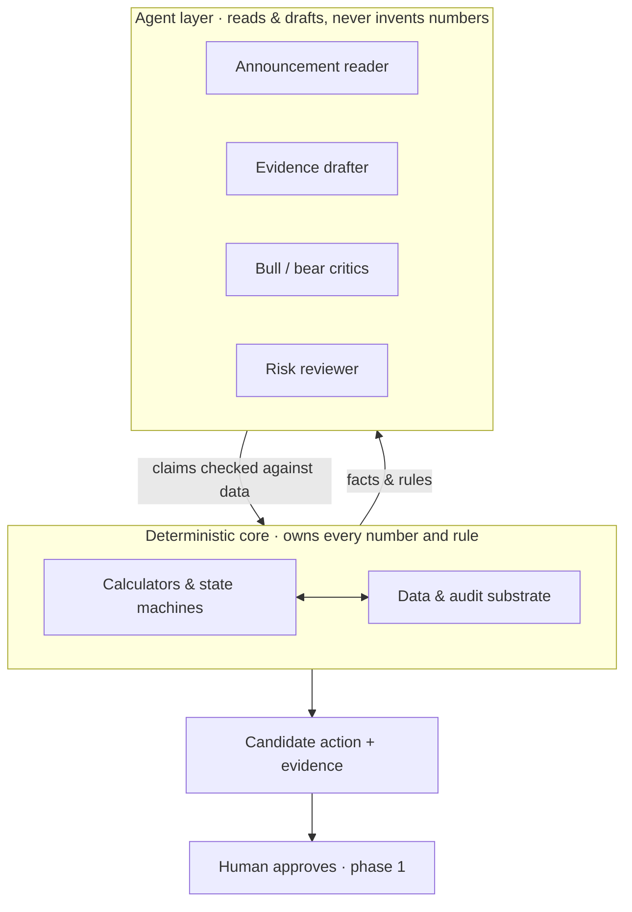

# How the System Works

> A plain-language guide to the dividend-investing system specified in [README.md](../README.md). This document explains **how the parts connect** — the spec itself defines each part's exact formulas and rules (chapter references are included throughout, e.g. "Ch. 5").
>
> Companion document: [Financial AI Agent Landscape (research)](../research/financial-ai-agent-landscape.md) — what the rest of the world is doing, and what we can reuse.

---

## 1. The goal in one sentence

**Build and manage a portfolio of quality dividend-paying companies, bought only at conservative prices, so that after-tax dividends cover household cash needs while total return compounds over 3–10+ years — with every decision driven by evidence, recorded, and reversible.**

Every stock goes through four checkpoints in order. Each checkpoint must pass before the next one matters, and every number the system uses must trace back to source data. Nothing is bought automatically; the system produces *candidates with evidence*, and a human confirms.

| Spec objective (Ch. 1.1) | Where it is enforced |
|---|---|
| Cash flow is sustainable | Stage 1 (research) + Stage 4 (monitoring) |
| Purchase price is reasonable | Stage 2 (valuation gates) |
| Principal is safe long-term | Stage 1 (veto layer) + Stage 2 (margin of safety) |
| Low-frequency management | Stage 4 (event-driven, not daily trading) |

---

## 2. The big picture

The system is a **pipeline with four stages, a data foundation underneath, and four cross-cutting layers on the side**. Feedback loops exist: monitoring can send a stock back to research (fundamentals changed) or valuation (price changed).

**How to read it:**

- **Main road** (solid arrows): one stock's journey — research it → price it → plan the entry → hold and monitor.
- **Foundation**: the pipeline only ever reads from the data layer; conclusions stop if data is missing or stale (Ch. 14.1).
- **Layers**: portfolio limits, taxes, and audit rules apply *at the stages where money and decisions happen* — they are not separate steps.
- **Backtest lab**: every numeric threshold used in the pipeline (payout bands, yield targets, percentiles, weights) starts as an unproven "research example" and may only become a live rule after backtesting (Ch. 15). Until then the system shows "待设置" rather than silently using defaults (Ch. 8).

**Map of the README onto this picture:** Ch. 2–4 → Stage 1 · Ch. 5–6 → Stage 2 · Ch. 6.3, 12 → Stage 3 · Ch. 7–8 → Stage 4 · Ch. 9–10 → layers · Ch. 11 → scoring used across stages · Ch. 13–14 → data + acceptance tests · Ch. 15 → backtest lab.

---

## 3. The data foundation: everything runs on it

**Input → Process → Output** framing for the whole system:

- **Input:** raw facts from exchanges, company disclosures (CNINFO), and price feeds — securities, dividend events, financial statements, valuation data, announcements.
- **Process:** deterministic calculators and state machines (the pipeline stages).
- **Output:** research conclusions, price points, tranche plans, alerts, cash-flow forecasts — all with evidence links and version history.

Three rules from the spec matter more than any formula:

1. **Point-in-time (时点口径).** Backtests and decisions may only use data that was *publicly available on the decision date* — announcement dates, not the date we imported it; original statements, not restated ones (Ch. 14.1). This is what separates a credible system from a fantasy backtest.
2. **Missing ≠ zero.** A missing metric is shown as missing with a reason code, never as 0, and blocks formal conclusions it would affect (Ch. 13, 14.1).
3. **Entity before ticker.** The system verifies the listed company and its real operating assets before analyzing anything (Ch. 2.1) — "industry is important" never equals "this is a buyable stock".

Data entities (Ch. 13) are linked by IDs — `security_id`, `dividend_id`, `event_id`, `version_id` — which is what makes every output traceable back to source.

---

## 4. Stage 1 — Research: is this a quality dividend payer?

The eight dimensions (Ch. 2) answer four questions, in a fixed order (Ch. 2.1):

| Question | Dimensions | Key evidence |
|---|---|---|
| Can it pay? | Dividend history · payout & sustainability · cash flow & debt · earnings quality | 5–10 yrs of DPS, payout ratio, FCF coverage, ROE |
| Will it pay? | Dividend willingness & governance | Dividend policy, history of honoring it, capital allocation |
| Is it safe? | Industry moat · material risks | Moat evidence, fraud/audit/license checks |
| At what price? | Purchase price | Feeds Stage 2 (scored here, enforced there) |

Two structural rules make this stage different from a simple screener:

- **The veto layer is absolute.** A confirmed material risk (fraud, broken business model, license loss) blocks the stock *regardless of every other score* (Ch. 2, 11). No number offsets it.
- **Industry templates prevent metric abuse.** Banks are judged by capital adequacy and asset quality, not by net-debt/EBITDA — deposits are a bank's business, not its debt (Ch. 3). Without a configured template, the system shows facts but no score or buy candidate (Ch. 3.2).

**Output:** a research label (qualified / watch / not-qualified / insufficient-data) plus an evidence packet — every claim dated, sourced, and reviewer-attributed. Only "qualified" continues.

---

## 5. Stage 2 — Valuation: is the price right?

This stage exists because of a single insight from Ch. 5: **a dividend paid in the past is not a promise about the future**. The system always asks what the *next* years' dividend will be, after tax, relative to today's price.

**Step 1 — Forecast sustainable DPS** (Ch. 4.3): normalized earnings × a reasonable payout ratio, capped by cash-flow or capital constraints, in three scenarios (conservative / base / stress). One-off special dividends are stripped out — they are windfalls, not income.

**Step 2 — Three yields, three meanings** (Ch. 5.1):

| Yield | Formula | Purpose |
|---|---|---|
| Historical (TTM) | last 12 months' actual dividends ÷ price | Describes the past only |
| **Forward sustainable** | forecast sustainable DPS ÷ price | **The only one that justifies a new buy** |
| Cost-basis | forecast DPS ÷ *your* entry cost | Comfort about existing holdings, not valuation |

Worked example from the spec: last year's DPS was 1.00, the sustainable forecast drops to 0.70, price is 15. Historical yield 6.67%, forward yield 4.67% — the 6.67% number is a mirage for a new buyer.

**Step 3 — The three gates** (Ch. 6.1):

The price formulas (Ch. 6.1):

- `P_target-yield = sustainable after-tax DPS ÷ target after-tax yield` — the income test.
- `P_safety-margin = conservative intrinsic value × (1 − margin-of-safety)` — the valuation test.
- `P_build = min(P_target-yield, P_safety-margin)` — **buy only below the stricter of the two.**

Worked example from the spec's own acceptance case (Ch. 14.2): DPS 1.00, tax 20% → after-tax DPS 0.80; target after-tax yield 5% → P_target = 16. If the safety-margin price is 18, then P_build = min(16, 18) = **16** — using the pre-tax 20 would be wrong.

Historical valuation percentiles (Ch. 5.2) add context — below the 20th percentile is the "undervalued research zone", above 90% is "suspend buys, consider trimming" — but a low percentile is *not* proof of cheapness (a bank's PB can drift down because its ROE genuinely deteriorated).

**Output:** three price points — P_build (entry ceiling), P_add (more attractive, fundamentals intact), P_overvalued (warning level) — each with its own valuation assumptions and version (Ch. 6.1).

---

## 6. Stage 3 — Plan & execute: how much, when?

Tranching (Ch. 6.3) is staged entry with a catch: **the calendar never overrides quality.** The reference plan is four tranches of 20/20/30/30 — e.g., a planned 100,000 yuan position becomes 20k / 20k / 30k / 30k. If a new financial report can't confirm dividend capacity, tranche 3 pauses *even though the plan said to buy*. Each tranche re-runs the full check (Ch. 6.3): DPS re-forecast, after-tax return, valuation, portfolio limits, red-alert status, data freshness.

At this stage the portfolio layer intervenes on every action (Ch. 9): single-stock weight ≤ 10–15% of the equity portfolio, single industry ≤ 30–35%, at least 3 (ideally 4–6) industries, and the cash pool must hold enough months of expenses that near-term spending never depends on unarrived dividends.

**Output:** the holdings ledger — every lot with dates, quantity, cost basis, and fees. This ledger exists for two reasons: cost-basis yield (Stage 2 feedback) and **tax reconciliation** (next section).

---

## 7. Stage 4 — Monitor: what changed?

The system is event-driven, not price-driven (Ch. 7.1). A price move alone never triggers a trade — it triggers a *re-assessment*. The alert pipeline (Ch. 8) watches:

| Trigger | Level | Response |
|---|---|---|
| Dividend cancelled or far below forecast | Red | Recompute DPS & price ranges; suspend adds pending review |
| Profit clearly down (non-cyclical) | Yellow | Investigate operating vs one-off causes |
| Cash flow can't cover dividends | Yellow/Red | Grade by duration and cause |
| Debt/refinancing pressure spikes | — | Suspend adds; redo debt scenarios |
| Policy/license/regulation change | — | Reassess long-term earnings and asset value |
| Governance: fraud, audit issues | High | Verify; removal if veto conditions met |
| Sudden crash or extreme valuation | — | Review only — no automatic trading |
| Weight limit exceeded | — | Evaluate rebalancing |

The re-assessment decision table (Ch. 7.1) keeps two concepts strictly separate:

| Situation | Decision |
|---|---|
| Fundamentals unchanged, price fell | Hold; add only if all buy conditions still pass |
| Fundamentals stable, valuation too high | Suspend buys; consider trimming (taxes, goals, alternatives) |
| Dividend capacity impaired, cause unclear | Pause adds; update stress scenarios; investigate |
| Fraud or permanently damaged business | Exit evaluation — evidence, disposal plan, restrictions |

**Trimming for valuation ≠ removal for fundamentals** (Ch. 7.3). Trimming adjusts the position size; removal re-judges whether the company still belongs in the portfolio at all. Removal keeps the full history — and restoring a removed stock requires *new* evidence plus a complete re-review.

**Output:** updated statuses, recorded decisions. This stage closes the loop: fundamental changes send a stock back to Stage 1, valuation changes back to Stage 2.

---

## 8. The portfolio & cash-flow layer

The household view sits *on top of* the stock pipeline and answers the actual goal question: does the portfolio pay for your life?

- **Coverage** (Ch. 9.2): `net annual dividends ÷ annual living expenses`. Worked example: 500k principal × 5% pre-tax = 25k gross; 20% tax → 20k net; expenses 150k → **13.3% coverage**. Static scenario, not a guarantee.
- **Cash pool** (Ch. 9.3): a buffer of N months' expenses smooths the mismatch between quarterly dividend arrivals and monthly spending. Below target → adjust withdrawals, reinvestment, or the plan.
- **Stress tests** (Ch. 9.3): dividend cuts, several industries stressed at once, adverse FX, a 20–30% drawdown — the spec explicitly says 20–30% is *not* the worst case.
- **Diversification by risk, not labels** (Ch. 9.1): banks, energy, and utilities are three industries that can all fall together on rates or policy.

---

## 9. The tax layer: why every lot is tracked

A-share dividend tax depends on **how long you held the shares** (Ch. 10, per 财税〔2015〕101号):

| Holding period | Dividend tax |
|---|---|
| ≤ 1 month | 20% |
| > 1 month to ≤ 1 year | 10% |
| > 1 year | Temporarily exempt |

The subtlety that drives the whole ledger design: for holdings under one year, tax is *usually not withheld at payment* — it is **reconciled when you sell**, based on actual holding period. So cash received today is not final after-tax income. The system shows "potential back-tax" per lot and never treats un-withheld as tax-free (Ch. 10.1). Hong Kong Connect dividends are simpler (20% withheld), but A+H comparisons must be done per line, after tax, in one currency (Ch. 10.2).

This is why the tranche ledger from Stage 3 exists: without per-lot dates, the 20/10/0 rules can't be applied, and the after-tax numbers feeding Stage 2 and the cash-flow layer would be wrong.

---

## 10. The audit layer: why every number is traceable

Three mechanisms (Ch. 12.3, 13) make the system reviewable:

1. **Versioning everywhere** — rules, thresholds, models, tax parameters, and restated financials all live as versions with effective dates; a published rule can never be silently rewritten.
2. **Decision snapshots** — every alert, score, and candidate action records *why it changed* (old value, new value, reason, person, time), so later reviews can distinguish company deterioration from valuation change from data revision from our own mistake (Ch. 15.4).
3. **Explainable candidates** — any "candidate buy" expands to show exactly which conditions it passed and what condition change would revoke it (Ch. 12.3).

---

## 11. The backtest lab: where parameters earn their status

Every number in this document — 30–70% payout bands, 4.5/5/6% yields, percentile cutoffs, tranche ratios, score weights — is explicitly **unproven** (README front matter, Ch. 15.2). The lab is the loop that tests them:

Backtest rules (Ch. 15.1) are strict: only data knowable at the time; delisted, halted, and dividend-cutting companies included; training/validation/out-of-sample separated; costs, taxes, FX, and dividend arrival timing included; results compared against dividend benchmarks and plain buy-and-hold — not just the best-looking parameter set. **Passing product acceptance is not proof of strategy validity** — that is the single most repeated disclaimer in the spec, and it is a design principle, not a legal footnote.

---

## 12. The whole system as software

For the developer, the spec decomposes cleanly (all components deterministic):

| Spec area | Software component |
|---|---|
| Ch. 13–14 | Data ingestion: securities, dividends, statements, prices, announcements; point-in-time rules; missing-data blocking |
| Ch. 4–6 | Calculators: payout, coverage, DPS scenarios, three yields, percentiles, DCF, five price points |
| Ch. 2, 7–8, 11 | State machines: research labels, alert lifecycle, tranche plans, veto layer; scoring engine (80/20 + veto) |
| Ch. 9–10 | Portfolio & cash-flow engine: weight caps, cash pool, coverage, tax-lot ledger with holding-period reconciliation |
| Ch. 15 | Event-driven backtester with train/validation/OOS separation |
| Ch. 12–13 | Audit substrate: versions, snapshots, rule promotion |

The Ch. 14 acceptance cases are a ready-made executable test suite — each row is a unit test with inputs and expected outputs (e.g., "DPS=1, tax 20%, target 5%, safety price 18 → build price 16").

---

## 13. Where the AI agent fits

The spec itself describes no AI — it is rules and formulas. The agent's natural home is the **research work**: reading announcements, drafting evidence, challenging assumptions. The numbers stay in the deterministic core.

Autonomy is a ladder, unlocked by backtest evidence rather than a calendar:

| Rung | What the agent does | Unlock condition |
|---|---|---|
| 1 · Research assistant | Analysis and drafting; human decides everything | Working data layer |
| 2 · Proposal agent | Candidate actions with full evidence; human approves | Ch. 14 acceptance suite passing |
| 3 · Rule executor | Executes only pre-approved, backtested rules; escalates the rest | Thresholds approved by the backtest lab |
| 4 · Fully autonomous | Discretionary decisions and execution | A body of validated evidence that does not exist yet — plus a regulatory review (this rung enters China's investment-advisory/asset-management territory) |

Guardrail (non-negotiable): the agent may only cite figures it fetched from the data layer — never generate a number — and every prompt/model/source version goes into the audit trail alongside the existing rule versions.

---

## 14. The system in time

- **Daily:** prices and announcements update; the alert pipeline ingests events (engineering target: 15 minutes from usable data, Ch. 8.2), recomputes affected models, notifies.
- **On a financial report:** re-run calculators, re-score, re-check tranche conditions — this is the moment tranche plans get confirmed or paused.
- **On a price move:** no trading — a review is triggered, that's all (Ch. 7.1).
- **On a red alert:** adds are blocked until the alert is resolved with a stated basis (Ch. 8.1).
- **Semi-annually to annually:** full portfolio review — asset quality, concentration, cash-flow goals, and whether the backtest lab should recalibrate anything (Ch. 15.4).
- **Always:** every change leaves an audit record.

---

## 15. Glossary (English ↔ her spec)

| English | 中文 (README) |
|---|---|
| dividend yield | 股息率 |
| payout ratio | 支付率 |
| free cash flow | 自由现金流 |
| margin of safety | 安全边际 |
| tranched position building | 分批建仓 |
| intrinsic value | 内在价值 |
| value trap | 价值陷阱 |
| ex-dividend / record date | 除权除息日 / 股权登记日 |
| normalized earnings | 正常化利润 |
| survivorship bias | 幸存者偏差 |
| look-ahead bias | 前视偏差 |
| point-in-time data | 时点口径 / 公告日可回溯数据 |
| restatement | 财报重述 |
| cash pool | 现金水池 |
| veto layer | 否决层 |
| forward sustainable yield | 可持续预期股息率 |

---

## 16. Open questions for the partner

1. **Data budget** — A-share data costs money (see the research doc §Data): roughly ¥200–1,500/yr for a usable tier; commercial feeds run ¥12k+/yr. Who pays, and what's the ceiling?
2. **Is the 15-minute alert SLA hard or aspirational?** (Ch. 8.2) — it decides push-feed vs polling architecture.
3. **Who is the user?** Just us, or external retail investors? External users change the compliance posture materially (investment-advisory regulation in China).
4. **Single-user vs multi-user** — Ch. 12.3 sketches role-splitting; the data model changes if it's real.
5. **Her comfort with agent-generated content in the product** — the rung ladder in §13 needs her explicit, staged sign-off.
